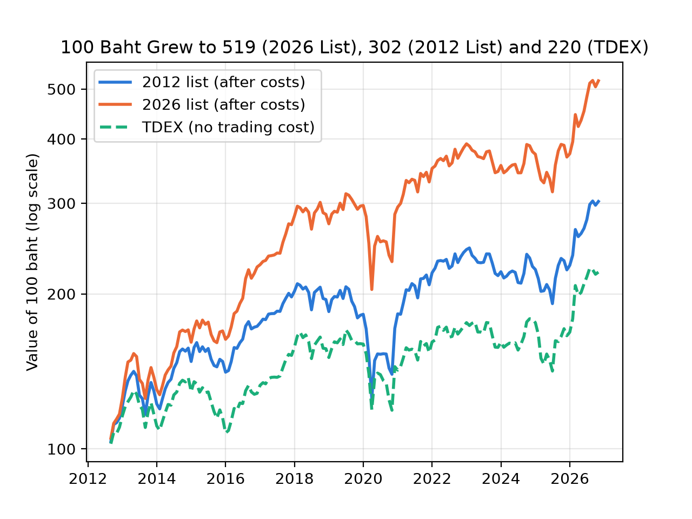
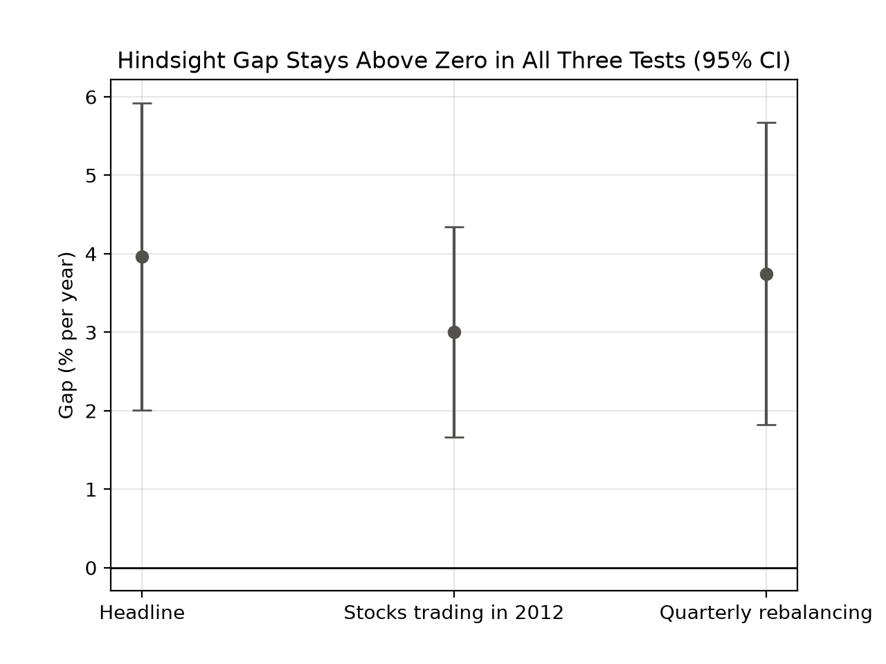
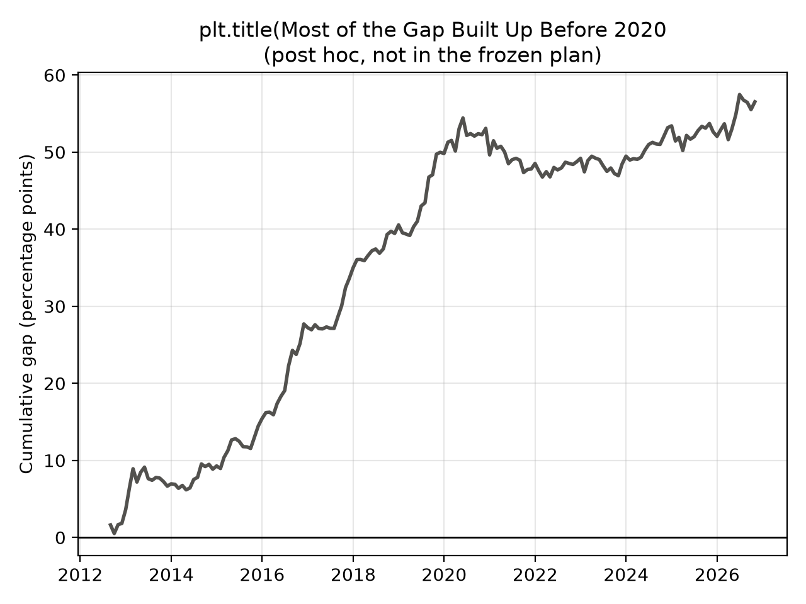

## Headline 
- The 2026 SET50 hindsight list outperformed the July 2012 SET50 list by 3.97 percentage points per year in annualized arithmetic returns (t = 3.98, 95% CI [2.01%, 5.92%]), under the pre-committed dropped-stock rule.
- In a backtest, the 2026 list returned about 4 percentage points more per year than the 2012 list, but an investor in 2012 could not have known the 2026 list.

## Scorecard

| | 2012 list | 2026 list | TDEX |
|---|---|---|---|
| CAGR | 8.07% | 12.24% | 5.70% |
| Sharpe | 0.56 | 0.76 | 0.44 |
| Max drawdown | −40.18% | −34.84% | −30.20% |

- The CAGR gap is 4.17 points, and it’s descriptive only. 
- TDEX is context only: it’s one fund with no trading cost taken out, and its result isn’t a fair skill comparison with the lists.

## What it means

- Statistical strength: The t-statistic of 3.98 clears both reference thresholds (2 and 3).
- Size of the gap: The 95% confidence interval is 2.01%–5.92%. The gap is likely positive, but its exact size remains uncertain.
- Costs: Costs did not explain the difference. The gap changed from 4.01% before costs to 4.00% after costs in the earlier version, before the BANPU and TRUE fixes. The final corrected result is 3.97%.
- Answer: under my rules, testing today’s list on the past flattered the result by about 4 points a year compared with the list available in 2012.

## Sensitivity checks
- Stocks trading in July 2012: The gap falls to 3.00% per year (t = 4.40, 95% CI [1.66%, 4.34%]). This version keeps SCB (D-14).
- Quarterly rebalancing: The gap is 3.75% per year (t = 3.81, 95% CI [1.82%, 5.68%]). Quarters end in January, April, July and October (D-15).

- How to read these results:
    - Both tests still show a positive return gap.
    - They support the headline result but do not replace it.
    - Both use the same underlying data, so they are not independent proofs.

## Power

- Planned: Volatility of the monthly gap, annualised, was expected to be about 8.4%, with a detectable gap of approximately 6.2%.
- Actual: Volatility of the monthly gap, annualised, was 3.77%, with a detectable gap of approximately 2.79%.
- What it means: The original plan was conservative. The actual data were less volatile than expected, allowing the test to detect smaller return differences than originally planned.

## Limitations and disclosures
- Dropped stocks: Eight stocks were dropped. The direction of any resulting bias is unknown (D-9).
- Missing history: TIDLOR's early years and SCB's pre-2022 history are missing. Real BANPU data ends on 14 Mar 2025 (D-11).
- Timing: Returns start in August 2012, not 2 July. Month-end closes represent the first trading day. Chart 1 starts at approximately 103, not 100.
- Sharpe ratio: No risk-free rate was used.
- List sizes: The 2012 list contains 41–42 stocks, while the 2026 list contains 35–49.
- THAI: Original data was kept unchanged, but the effect of restructuring on old shareholders is not fully confirmed.
- BEM: Yahoo's pre-2016 prices probably belong to a predecessor, but this is unconfirmed.
- Comparisons: Thai market results and US Quantz Dow results are not directly comparable.
- Full details: All data checks and their limitations are documented in DATA_CHECKS.md.
- TDEX: Didn’t check whether Yahoo’s adjusted prices include every fund distribution. If some are missing, TDEX’s 5.70% is too low.

## Deviations 
- BANPU: switched to Mendeley (D-11).
- TRUE: removed the fake jump (D-12). The ratio was in the plan, but the fix came after the first run.
- Effect: together, 4.00% to 3.97%.
- Timing: month-end closes stand in for the first trading day.

## Post hoc: (not part of the frozen plan)
- This split wasn't in PLAN.md so it is exploratory.
- By the end of 2019: The cumulative return gap had reached +49.8 percentage points.
- From 2020 to 2026: The gap added another +6.7 percentage points.
- Limit: This analysis shows when the gap appeared, but it does not explain why it happened or prove that the effect has ended.

